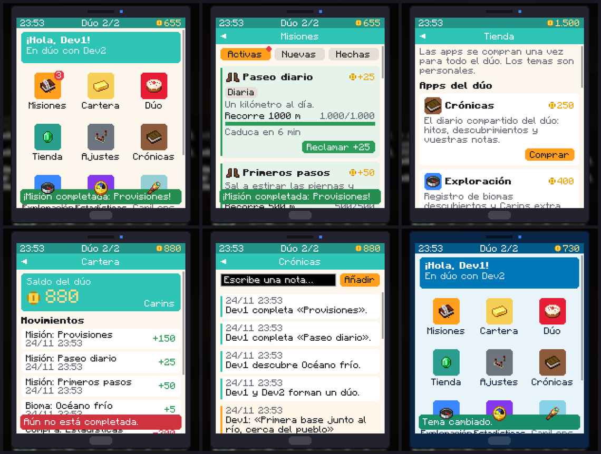

# Caricraft Mod

Mod Fabric para Minecraft 1.21.1 pensado para el servidor privado Caricraft 2 (modpack COBBLEVERSE 1.8.0).

Incluye un teléfono dentro del juego, el **CariPhone**, con aplicaciones desbloqueables, una moneda propia (**Carins**), misiones individuales y cooperativas, vínculo de dúo, crónicas compartidas y exploración.

- Estado: en desarrollo (ver `ROADMAP.md` y `CHANGELOG.md`).
- Versiones: Minecraft 1.21.1 · Fabric Loader 0.19.5 · Fabric API 0.116.18 · Java 21 · Cobblemon 1.8.4 opcional.

Documentación: `00_LEEME_PRIMERO.md`, `docs/` y `prompts/`.



## Uso rápido
- Al entrar por primera vez recibes un **CariPhone**. También se fabrica con 5 lingotes de hierro, 1 panel de cristal y 1 redstone.
- Ábrelo con clic derecho o con la tecla `O` (configurable).
- Comandos: `/carins` (saldo), `/caricraft duo invite|accept|decline <jugador>`, `/caricraft duo leave`.
- Administración (nivel 2): `/carins give|take|set <jugadores> <cantidad>`, `/caricraft info <jugador>`, `/caricraft reload`.
- Configuración: `config/caricraft.json`. Misiones personalizadas: `config/caricraft_missions.json` (ver `docs/MISSIONS.md`).

## Compilar
```bash
./gradlew build
```
El JAR queda en `build/libs/caricraft-<versión>.jar`. Se instala en el servidor **y** en los clientes junto a Fabric API.
