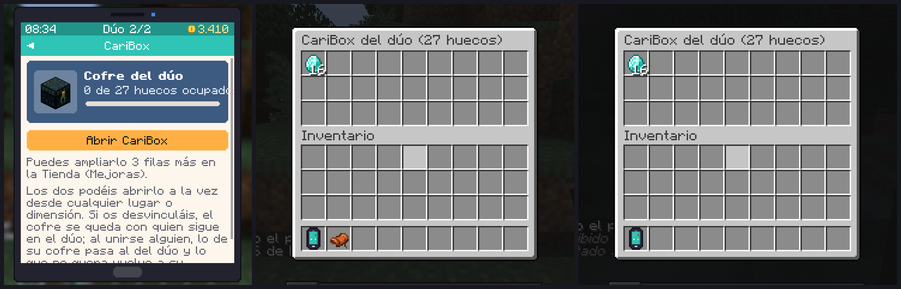

# CariBox

App de pago del dúo (400 Carins, cofre de ender): un **cofre compartido** que se abre desde el CariPhone, estés donde estés.

## Funcionamiento
- "Abrir CariBox" abre un cofre normal de Minecraft con el contenido del dúo, en cualquier lugar o dimensión.
- Los dos miembros pueden tenerlo abierto **a la vez** y ven los cambios del otro al instante, como en un cofre compartido.
- **Tamaño:** 27 huecos (3 filas). La mejora "Ampliación de CariBox" (250 Carins, hasta 3 veces) añade una fila cada vez, hasta 54 huecos.
- Al ampliarlo, si el compañero lo tenía abierto con el tamaño anterior, se le cierra en ese mismo instante para que no se puedan duplicar objetos.

## Vincular y desvincular
- **Al unirse alguien a un dúo**, lo que tenía en su CariBox individual pasa al del dúo. Lo que no quepa vuelve a su inventario (o cae a sus pies) y se le avisa.
- **Al desvincularse**, el cofre se queda con quien sigue en el dúo. Quien se va empieza con uno vacío, aunque conserva la app y sus ampliaciones.

## Por dentro
- El contenido se guarda en `data/caricraft.dat`, junto al resto del estado, con el códec oficial de objetos (componentes y encantamientos incluidos). Los cofres vacíos y los de grupos que ya no existen no se guardan.
- El núcleo (`BoxService`) solo decide permisos y tamaño. Los objetos los gestiona el servidor (`CariBoxManager`).

## Por qué no duplica el modpack
COBBLEVERSE trae mochilas y almacenamiento (Sophisticated Backpacks/Storage, Tom's Storage), pero son personales o están fijos en un sitio. El cofre de ender vanilla es individual. CariBox es el único almacén **compartido por el dúo y accesible desde cualquier parte**.
