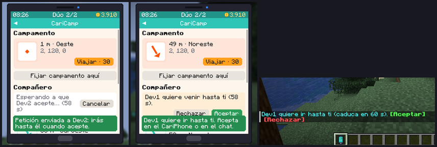

# CariCamp

App de pago del dúo (500 Carins, hoguera naranja).

## Funciones
- **Campamento:** junto a una **hoguera encendida** (a 3 bloques como mucho), "Fijar campamento aquí" la guarda como campamento del dúo. Solo hay uno; volver a fijarlo lo mueve.
- **Brújula:** la app muestra una flecha y la distancia (con punto cardinal) al campamento y a cada compañero conectado. La flecha tiene en cuenta hacia dónde mira el jugador. Si el destino está en otra dimensión, se indica.
- **Viajes con el compañero, al estilo /tpa:**
  - **Ir**: pides ir hasta tu compañero. **Traer**: le pides que venga contigo.
  - El compañero recibe un aviso, un mensaje en el chat con **[Aceptar] [Rechazar]** clicables y la petición en su CariPhone. También vale `/tpduo aceptar` o `/tpduo rechazar`.
  - La petición caduca a los `camp.requestSeconds` (60 s). Una nueva sustituye a la anterior.
  - Tras aceptar empieza una **cuenta atrás** de `camp.warmupSeconds` (3 s). Si quien viaja se mueve, se cancela.
  - Se cobra al llegar: `camp.partnerTravelCost` (50 Carins), con `camp.cooldownSeconds` (5 min) de espera para quien viaja.
- **Viaje al campamento:** `camp.campTravelCost` (30 Carins). No necesita aceptación, pero sí la misma cuenta atrás sin moverse.
- **Durante la noche de desafío no se puede viajar** (`camp.blockDuringChallenge`), ni pedirlo ni completarlo.
- **Reglas de la hoguera:** el viaje al campamento busca un hueco seguro (suelo firme y dos bloques de aire) junto a ella.
  - Si se ha **apagado**, no se puede viajar hasta volver a encenderla (no se cobra).
  - Si se ha **roto**, el campamento se borra.
- Las posiciones solo se envían a los miembros del propio dúo.

## Comandos
| Comando | Qué hace |
|---|---|
| `/tpduo` o `/tpduo ir` | Pide ir hasta tu compañero |
| `/tpduo traer` | Pide que tu compañero venga contigo |
| `/tpduo aceptar` / `/tpduo rechazar` | Responde a la petición recibida (rechazar también cancela la tuya) |
| `/tpduo campamento` | Viaja al campamento |

`/caricraft viaje …` funciona igual.

## En qué se diferencia de Waystones
| | Waystones | CariCamp |
|---|---|---|
| Destino | Piedras fijas repartidas por el mundo | Tu compañero (estés donde estés) y un único campamento propio |
| Consentimiento | No | El compañero tiene que **aceptar** (como /tpa) |
| Ida y vuelta | Solo ir | **Ir** hasta él o **traerlo** contigo |
| Coste | Experiencia | Carins, al llegar |
| Tiempo | Inmediato | Cuenta atrás sin moverse y espera entre viajes |
| Noche de desafío | Sin restricción | Bloqueado |
