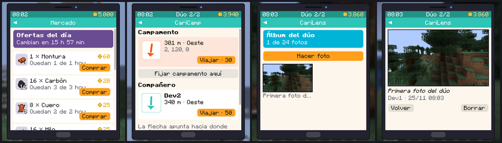

# CariLens

App de pago del dúo (300 Carins, catalejo azul): un **álbum de fotos compartido**.

## Uso
1. "Hacer foto": el teléfono se esconde, se oculta la interfaz durante un instante y se captura lo que ves.
2. Aparece la vista previa (256×144). Se puede escribir un pie de foto (opcional, 80 caracteres) y pulsar **Guardar**, o **Descartar**.
3. La foto aparece en el álbum de los dos miembros, con aviso al compañero y una entrada en las Crónicas.
4. Al tocar una miniatura se abre en grande con su pie, autor y fecha. Cualquier miembro puede **borrarla** (con confirmación).

## Capacidad
- 12 fotos de base (`lens.basePhotos`).
- **Ampliación de álbum:** mejora de la Tienda, 200 Carins, se compra hasta 4 veces y da +12 fotos cada vez (`lens.photosPerExpansion`). Con todas, 60 fotos.

## Por dentro
- **Cliente:** captura el framebuffer sin interfaz, recorta al centro a 16:9, promedia a 256×144 y codifica el PNG RGB con un codificador propio en Java puro (`PngCodec`, con tests). Pesa unos 40–70 KB.
- **Subida:** en trozos de 30 KB (el límite de los paquetes del cliente es 32 KiB), como máximo 6. El servidor comprueba:
  - el orden y la identidad de los trozos;
  - el tamaño (`lens.maxPhotoBytes`, 160 KB);
  - la firma y la cabecera PNG (CRC);
  - las dimensiones (32×18 a 320×180);
  - que haya hueco en el álbum;
  - el tiempo entre fotos (`lens.uploadCooldownSeconds`).
- **Almacenamiento:** `<mundo>/data/caricraft_photos/<id>.png`. El estado del dúo solo guarda los metadatos. Al desvincular, los dos conservan el álbum; el archivo solo se borra cuando ningún grupo lo usa.
- **Descarga:** bajo demanda (`photo_data`), solo para miembros del grupo. Se cachea como textura y se libera al desconectarse.
- No se sube nada a internet ni a servicios externos.

## Por qué no duplica el modpack
La Pokédex de Cobblemon registra especies. CariLens guarda momentos del dúo con fotos reales del mundo.
