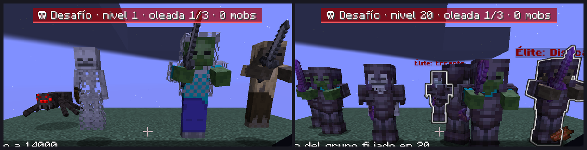

# Desafío Dúo

Noches de desafío con mobs vanilla equipados. Es una app de serie del CariPhone (calavera roja).

## Reglas
- Cada `intervalNights` noches (por defecto **3**) hay un **desafío obligatorio**.
- El dúo puede **adelantarlo** a la noche actual desde la app. Cuenta como el obligatorio y reinicia la cuenta.
- Durante la noche de desafío:
  - **No se puede dormir** (evento `ALLOW_SLEEPING` de Fabric). Cubre las camas; los sacos de Comforts también, si usan el sueño vanilla (sin probar).
  - Aparecen los mobs de `challenge.mobs` (por defecto zombi, momia, ahogado, esqueleto, esqueleto glacial, araña, araña de cueva, bruja, slime y enderman) **equipados y reforzados**.
  - Cada mob derrotado da `killReward + nivel - 1` Carins (por defecto 2–6).
  - Los viajes de CariCamp están bloqueados.
- **Al amanecer**:
  - Si el dúo sigue conectado, gana `nightReward` (por defecto 50) y la noche cuenta como superada.
  - Los mobs del desafío desaparecen.
- Fuera del desafío **no aparecen** esos mobs: el mundo queda como siempre en COBBLEVERSE.

## Niveles: cada vez más fuertes

- **Un nivel más por cada noche superada** (`nightsPerLevel` = 1), hasta `maxLevel` (por defecto **30**, configurable hasta 100).
- **Oleadas:** dentro de cada noche, la segunda oleada (desde medianoche) suma +1 nivel y la tercera (de madrugada) +2 (`waves`).
- **Élites:** probabilidad del 4 % + 1 % por nivel (máx. 25 %). Tienen +3 niveles de equipo, brillan, llevan el nombre "Élite: …" y dan el triple de Carins (`elites`).
- **Hordas:** con probabilidad del 3 % por nivel (máx. 50 %), un mob aparece acompañado de otro igual (`hordes`).
- **Por cada nivel:** +12 % de vida, +8 % de daño, +2 % de velocidad (máx. +25 %), resistencia al empuje (máx. 60 %) y más alcance de detección. Los zombis también llaman más refuerzos.

| Nivel | Armadura | Armas | Efectos |
|---|---|---|---|
| 1–2 | Cota de malla | Espada de piedra o de hierro; arco con Poder I | — |
| 3–5 | Hierro, Protección I | Hacha o espada de hierro, Filo I; Poder II–IV, Retroceso | — |
| 6–9 | Hierro y diamante, Protección II–III | Espada de diamante, Filo II–III, Aspecto ígneo; Poder V, Fuego | Velocidad I (6+), Fuerza I (8+) |
| 10–14 | Diamante, Protección IV, Espinas | Hacha de diamante, Filo IV–V, Empuje | Resistencia I (10+), Resistencia al fuego (12+), Velocidad II (14+) |
| 15–19 | Diamante y netherita | Espada de netherita o hacha de diamante | Fuerza II (16+), Regeneración (18+) |
| 20+ | Netherita completa, Protección IV, Espinas III | Espada o hacha de netherita, Filo V, Aspecto ígneo II | Resistencia II (20+), Regeneración II (26+) |

Las arañas no llevan equipo y reciben los efectos 2 niveles antes. El equipo solo cae al morir un 4 % de las veces.

**Recompensa por mob:** `killReward + nivel / 2` (2 Carins a nivel 1, 12 a nivel 20), el triple si es élite.

**Servidores que ya tenían `config/caricraft.json`:** se migran solos a la versión 2. Si seguían con los valores antiguos (máx. 5 y un nivel cada 2 noches) pasan a 30 y 1; si el administrador los había cambiado, se respetan.

## Misiones de caza
`first_challenge`, `night_hunter`, `duo_survivors`, `duo_trophies`, `elite_hunters`, `daily_hunt`, `weekly_hunt`, `milestone_hunter` y `milestone_nights` (ver `default_missions.json`). Usan:
- `KILL_ENTITY` con el objetivo `challenge` (solo cuentan los mobs del desafío).
- `CHALLENGE_NIGHT` (sobrevivir hasta el amanecer).

Si `challenge.enabled` es `false`, la app y estas misiones desaparecen.

## Preparar un servidor COBBLEVERSE
COBBLEVERSE bloquea estos mobs con **MobsBeGone**, que los borra al entrar al mundo (`config/mobsbegone-blacklist.json`). Hay que sacarlos de esa lista **una vez**:

1. En el servidor, como operador (nivel 3) o desde la consola: `/caricraft desafio preparar`. Quita de la lista los mobs de `challenge.mobs` y guarda una copia en `mobsbegone-blacklist.json.caricraft.bak`.
2. Reiniciar el servidor.
3. Comprobar con `/caricraft desafio estado`. Si algo sigue bloqueado, el log y la app lo avisan.

Para hacerlo a mano, basta con borrar esas entradas del JSON.

## Cómo funciona por dentro
- `ChallengeService` (núcleo, con tests) lleva la cuenta de noches.
  - El índice de día cambia **al amanecer** (tick 23000), así que cada noche pertenece al día de la tarde anterior.
  - El estado solo avanza mientras algún miembro está conectado.
- El mixin `ServerLevelChallengeMixin` se engancha en `ServerLevel.addFreshEntity`, el mismo punto que usa MobsBeGone.
  - Si no hay un dúo en desafío a menos de `radius` bloques, impide la aparición. Esto cubre aparición natural, spawners, conversiones y comandos.
  - Si lo hay, etiqueta el mob (`caricraft_challenge`) y lo equipa.
- Al cargar chunks se retiran los mobs etiquetados que quedaron de noches pasadas.
- Comandos de administración: `/caricraft desafio iniciar|terminar|nivel <n>` (nivel 2).
