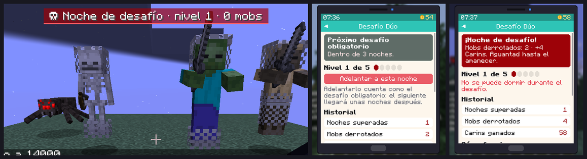
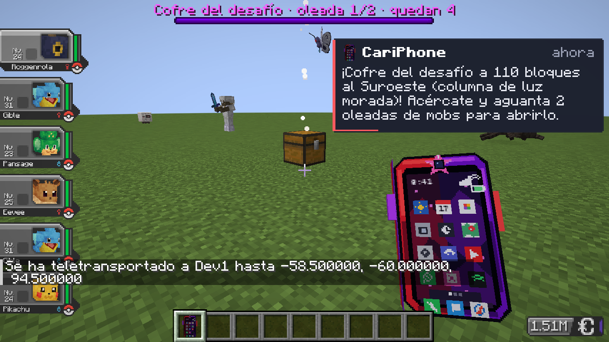
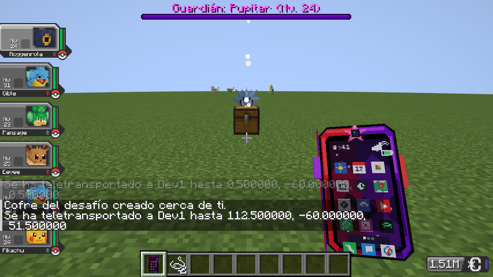
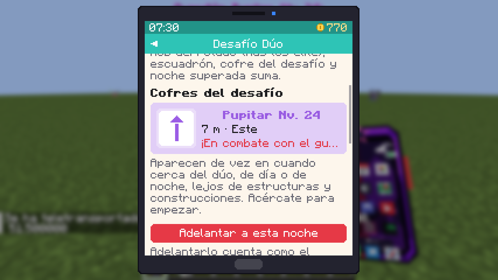
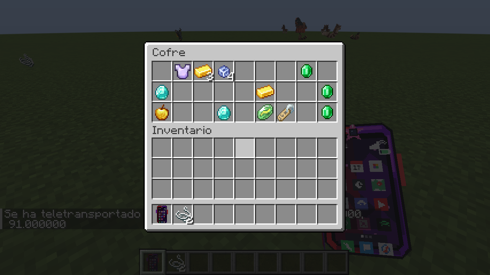
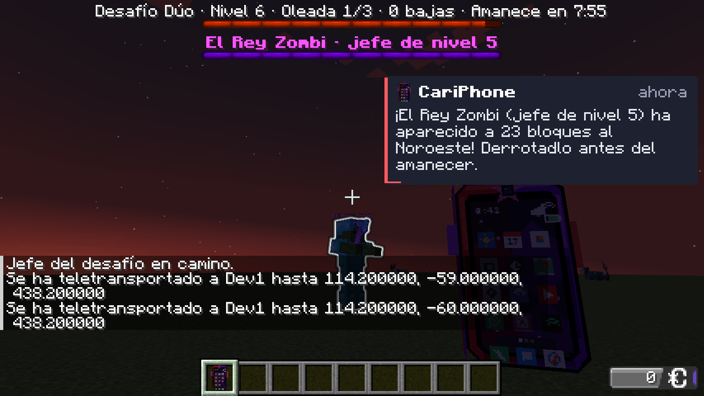
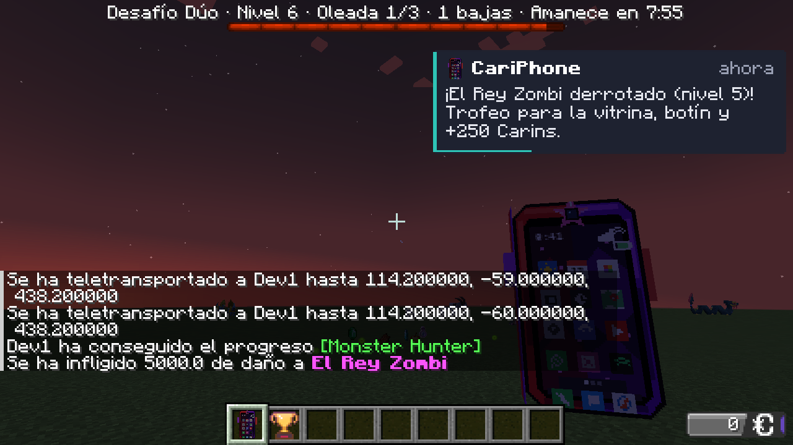

# Desafío Dúo

Noches de desafío con mobs vanilla equipados. Es una app de serie del CariPhone (calavera roja).

## Reglas
- Cada `intervalNights` noches (por defecto **3**) hay un **desafío obligatorio**.
- El dúo puede **adelantarlo** a la noche actual desde la app. Cuenta como el obligatorio y reinicia la cuenta.
- Durante la noche de desafío:
  - **No se puede dormir** (evento `ALLOW_SLEEPING` de Fabric). Cubre las camas; los sacos de Comforts también, si usan el sueño vanilla (sin probar).
  - Aparecen los mobs de `challenge.mobs` (por defecto zombi, momia, ahogado, esqueleto, esqueleto glacial, araña, araña de cueva, bruja, slime y enderman) **equipados y reforzados**.
  - Cada mob derrotado da `killReward + nivel - 1` Carins (por defecto 2–6).
  - Los viajes de CariCamp y TP Dúo están bloqueados.
- **Al amanecer**:
  - Si el dúo sigue conectado, gana `nightReward` (por defecto 50) y la noche cuenta como superada.
  - **Desaparecen todos los mobs del desafío**, estén donde estén: también los que se quedaron lejos o en zonas sin cargar (se retiran en cuanto esa zona se carga). Se van con una nube de humo: **no cuentan como kill**, no dan Carins ni experiencia y no sueltan nada.
  - Además, cada 10 s se retiran los que sobren (de día, o lejos de cualquier dúo en desafío). Así no ocupan el límite de entidades que comparten con los Pokémon de Cobblemon.
- **Las kills de tus Pokémon cuentan como tuyas:** si un Pokémon sacado (o cualquier mascota con dueño, como un lobo) da el golpe final, la kill, los Carins y la experiencia son para su entrenador.
- Fuera del desafío **no aparecen** esos mobs: el mundo queda como siempre en COBBLEVERSE.

## Cofres del desafío por el mundo
Para que el equipo bueno (armaduras y espadas encantadas) tenga sentido también fuera de la noche de desafío.

| Emboscada | Pokémon guardián |
|---|---|
|  |  |

- **Cuándo:** cada `chestIntervalMinutes` (20) minutos, con probabilidad `chestChance` (75 %), aparece un cofre cerca de un miembro del dúo conectado. El primero tras entrar, a los 5 minutos. Sale de día o de noche, pero no durante la noche de desafío (ahí ya están los escuadrones). Uno a la vez por dúo.
- **Dónde:** en la superficie, a 60–140 bloques del jugador, en un sitio que **no estorba**:
  - Sin ninguna estructura a menos de 32 bloques (aldeas, templos, estructuras de Cobbleverse…).
  - Sin bloques con datos de jugador cerca (cofres, hornos, carteles, camas…: huele a construcción). Las colmenas naturales no cuentan.
  - A cielo abierto, sobre suelo firme, sin agua ni lava y lejos de otros cofres del desafío.
- **Aviso:** notificación con distancia y dirección, una **columna de luz morada** sobre el cofre y una tarjeta con brújula en la app Desafío (con el tiempo que le queda).
- **Cómo se gana:**
  - **Emboscada:** al acercarte a 10 bloques salen oleadas de mobs alrededor del cofre: 2 oleadas (niveles 1–9), 3 (10–19) o 4 (20 o más), de 3 mobs más uno cada 4 niveles (máx. 8). La última trae un **capitán** élite. A partir del nivel 8 también hay vindicadores, saqueadores y brujas. Llevan el equipo de su nivel, **casco y resistencia al fuego** (de día el sol no los quema). Barra morada con la oleada y los que quedan.
  - **Pokémon guardián** (con Cobblemon, `chestGuardianChance` = 40 %): un Pokémon salvaje fuerte que brilla junto al cofre. Nivel `12 + 2 × nivel de desafío` (máx. 80); especie según el nivel (Machoke, Haunter, Pupitar… → Machamp, Gengar, Lucario… → Tyranitar, Garchomp, Metagross…). Hay que **derrotarlo en combate o capturarlo** (y te lo quedas). Si desaparece sin combate, vuelve a salir.
  - Si el dúo se aleja más de 40 bloques durante 20 s, los atacantes (o el guardián) se retiran y se puede volver a intentar.
- **Premio:**
  - Botín de las tablas `data/caricraft/loot_table/challenge/world_chest_1..3.json` (cambiables con datapack), siempre con una pieza de **equipo encantado**: hierro (encantamiento de nivel 10–20), diamante (20–30) o diamante y netherita (30–39), además de diamantes, esmeraldas, manzanas de oro, tótems, libros (con Reparación en la tabla 3), chatarra o lingote de netherita…
  - Con Cobblemon, 2–3 objetos de Cobblemon más (Super/Ultra Balls, caramelos, piedras evolutivas, vitaminas, Cápsula o Parche habilidad, Huevo Suerte y, rara vez, una Master Ball).
  - En las emboscadas, a veces (10/20/30 % según la tabla) **un Pokémon** para quien lo conquista.
  - `chestReward + 5 × nivel` Carins (por defecto 30 + 5 por nivel), `xpPerChest` (40) de experiencia de desafío y una crónica.

  
- **Si nadie lo gana** en `chestLifetimeMinutes` (30) minutos, se desvanece. Cerrado no se abre ni se rompe; al parar el servidor no queda ninguno.
- Admin: `/caricraft desafio cofre [emboscada|guardian]` saca uno ya cerca del jugador (nivel 2).

## Escuadrones con botín
Además de los mobs normales del desafío, de vez en cuando aparece cerca del dúo un **escuadrón protegiendo un cofre de botín** (`challenge.squads`).
- **Cuántos:** 1 por noche, y uno más cada 8 niveles, hasta `maxSquadsPerNight` (3). Se reparten a lo largo de la noche.
- **Dónde:** en la superficie, a 24–40 bloques de un miembro del dúo que esté en el mundo normal.
  - Se avisa con una notificación que dice la distancia y la dirección: «¡Un escuadrón de 3 guarda un botín a 25 m al Sur!».
  - Sobre el cofre sale una columna de llamas de alma visible de lejos.
  - La app Desafío Dúo lo muestra en «Botines de esta noche», con brújula, distancia y guardias que quedan.
- **El escuadrón:**
  - Tiene 3 mobs, y uno más cada 5 niveles (máx. 7): zombis, momias, esqueletos, esqueletos glaciales y arañas, si están en `challenge.mobs`.
  - Llevan un nivel más de equipo y no se alejan del cofre.
  - El **capitán** brilla, lleva el nombre «Capitán: …» y +3 niveles.
- **Cofre bloqueado:** no se abre ni se rompe mientras quede algún guardia. Al intentarlo se avisa de cuántos quedan.
- **Al derrotarlo:**
  - El cofre se abre y da `squadReward + 5 × nivel` Carins (por defecto 40 + 5 por nivel).
  - Además, una entrada en las Crónicas y la estadística «Escuadrones derrotados».
- **Botín:** tablas de botín propias por nivel (`data/caricraft/loot_table/challenge/squad_cache_1..3.json`). Se pueden cambiar con un datapack.
  - Nivel 1–9: hierro, oro, esmeraldas, comida, flechas, frascos de experiencia, libros encantados y, a veces, un diamante.
  - Nivel 10–19: además diamantes, perlas, manzanas de oro, chatarra de netherita y espadas de diamante encantadas.
  - Nivel 20 o más: más diamantes y esmeraldas, bloques de oro, armadura y pico de diamante encantados, tótems y, rara vez, una manzana de oro encantada.
- **Al amanecer** (o con `/caricraft desafio terminar`) los cofres que no se han ganado desaparecen con sus guardias. Los ya abiertos se quedan.
- Los escuadrones viven en memoria: al parar el servidor se quitan los cofres que seguían bloqueados.

## Barra de la noche
Barra de jefe del dúo (`challenge.bossBar`, activada). La ven los miembros conectados en el mundo normal.
- **Amarilla, en los 75 s antes de anochecer** si esa noche toca desafío: «El Desafío Dúo empieza en 1:00: ¡prepárate!».
- **Roja durante la noche:** «Desafío Dúo · Nivel 2 · Oleada 2/3 · 5 bajas · Amanece en 4:10».
  - Se vacía a medida que se acerca el amanecer.
  - El nivel incluye el extra de la oleada.
  - Sustituye al indicador que antes había arriba en pantalla.

## Niveles: cada vez más fuertes

- **El nivel sube con la experiencia**, hasta `maxLevel` (por defecto **30**, configurable hasta 100). Suman experiencia:
  - Cada mob derrotado: `xpPerKill` (3) + nivel del mob / 5; el triple si es élite. **Cuantas más kills en una noche, antes se sube.**
  - Cada escuadrón: `xpPerSquad` (25). Cada cofre del desafío: `xpPerChest` (40), y sus atacantes cuentan como kills.
  - Cada noche superada: `xpPerNight` (60).
  - Para pasar del nivel 1 al 2 hacen falta `xpPerLevel` (150) y cada nivel pide un `xpGrowth` (10 %) más: 150, 165, 180… Una noche con unas 30 kills da para subir un nivel al principio; más adelante hacen falta más.
  - La app Desafío muestra la barra de experiencia hasta el siguiente nivel, y al subir llega un aviso.
  - Los dúos que ya jugaban conservan su nivel (se les da la experiencia de ese nivel).
- **Oleadas:** dentro de cada noche, la segunda oleada (desde medianoche) suma +1 nivel y la tercera (de madrugada) +2 (`waves`).
- **Élites:** probabilidad del 4 % + 1 % por nivel (máx. 25 %). Tienen +3 niveles de equipo, brillan, llevan el nombre "Élite: …" y dan el triple de Carins (`elites`).
- **Hordas:** con probabilidad del 3 % por nivel (máx. 50 %), un mob aparece acompañado de otro igual (`hordes`).
- **Por cada nivel:** +12 % de vida, +8 % de daño, +2 % de velocidad (máx. +25 %), resistencia al empuje (máx. 60 %) y más alcance de detección. Los zombis también llaman más refuerzos.

| Nivel | Armadura | Armas | Efectos |
|---|---|---|---|
| 1–2 | Cota de malla | Espada de piedra o de hierro; arco con Poder I | — |
| 3–5 | Hierro, Protección I | Hacha o espada de hierro, Filo I; Poder II–IV, Retroceso | — |
| 6–9 | Hierro y diamante, Protección II–III | Espada de diamante, Filo II–III, Aspecto ígneo; Poder V, Fuego | Velocidad I (6+), Fuerza I (8+) |
| 10–14 | Diamante, Protección IV, Espinas | Hacha de diamante, Filo IV–V, Empuje | Resistencia I (10+), Resistencia al fuego (12+), Velocidad II (14+) |
| 15–19 | Diamante y netherita | Espada de netherita o hacha de diamante | Fuerza II (16+), Regeneración (18+) |
| 20+ | Netherita completa, Protección IV, Espinas III | Espada o hacha de netherita, Filo V, Aspecto ígneo II | Resistencia II (20+), Regeneración II (26+) |

Las arañas no llevan equipo y reciben los efectos 2 niveles antes. El equipo solo cae al morir un 4 % de las veces.

**Recompensa por mob:** `killReward + nivel / 2` (2 Carins a nivel 1, 12 a nivel 20), el triple si es élite.

**Servidores que ya tenían `config/caricraft.json`:** se migran solos a la versión 2. Si seguían con los valores antiguos (máx. 5 y un nivel cada 2 noches) pasan a 30 y 1; si el administrador los había cambiado, se respetan.

## Jefes del desafío

- **Cada 5 niveles** (`bossEvery`) hay un jefe: al llegar al nivel 5, en la siguiente noche de desafío aparece cerca del dúo (a unos 20–30 bloques, unos 100 s después de anochecer). Avisa con distancia y dirección, sonido y barra de jefe morada para quien esté a menos de 64 bloques.
- Son **versiones gigantes y reforzadas de los mobs del desafío**, así que funcionan con MobsBeGone en COBBLEVERSE igual que el resto (los vindicadores, devastadores o esqueletos wither los bloquea el modpack):

| Nivel | Jefe | Vida | Tamaño |
|---|---|---|---|
| 5 | El Rey Zombi | 144 | ×1,8 |
| 10 | La Reina Araña | 210 | ×2,2 |
| 15 | El Capitán Esqueleto | 272 | ×1,6 |
| 20 | La Gran Bruja | 360 | ×1,6 |
| 25 | El Coloso del Fin | 480 | ×1,5 |
| 30 | El Ahogado Abisal (con tridente) | 616 | ×1,8 |

  La vida y el daño crecen con el nivel (+4 % por nivel sobre su base) y, a partir del nivel 35, empieza otra vuelta un 50 % más fuerte. Llevan el equipo del desafío de su nivel + 5, brillan y no se dejan empujar fácilmente.
- **Al derrotarlo** (el golpe final de alguien del dúo o de su Pokémon):
  - Cada miembro conectado recibe un **Trofeo del desafío** con el nombre del jefe, el nivel, el dúo y la fecha. Es decorativo y queda también en la **Vitrina** (`docs/ROUTINE.md`).
  - `bossReward` (150) + 20 Carins por nivel, `xpPerBoss` (150) de experiencia y botín en el suelo: diamantes, esmeraldas, manzanas de oro, frascos de experiencia y, desde el nivel 15, restos de netherita (desde el 25, una manzana de oro encantada).
  - Queda en las Crónicas.
  
- Si sale el sol antes de derrotarlo, se retira con el resto del desafío y **vuelve en la siguiente noche de desafío**. Cada jefe solo se puede derrotar una vez.
- La app Desafío muestra el jefe pendiente o el próximo, la vida del que está en combate y cuántos trofeos lleváis.
- `/caricraft desafio jefe` (nivel 2, con la noche de desafío en marcha) lo saca ya para probar.

## Misiones de caza
`first_challenge`, `night_hunter`, `duo_survivors`, `duo_trophies`, `elite_hunters`, `daily_hunt`, `weekly_hunt`, `milestone_hunter` y `milestone_nights` (ver `default_missions.json`). Usan:
- `KILL_ENTITY` con el objetivo `challenge` (solo cuentan los mobs del desafío).
- `CHALLENGE_NIGHT` (sobrevivir hasta el amanecer).

Si `challenge.enabled` es `false`, la app y estas misiones desaparecen.

## Preparar un servidor COBBLEVERSE
COBBLEVERSE bloquea estos mobs con **MobsBeGone**, que los borra al entrar al mundo (`config/mobsbegone-blacklist.json`). Hay que sacarlos de esa lista **una vez**:

1. En el servidor, como operador (nivel 3) o desde la consola: `/caricraft desafio preparar`. Quita de la lista los mobs de `challenge.mobs` y guarda una copia en `mobsbegone-blacklist.json.caricraft.bak`.
2. Reiniciar el servidor.
3. Comprobar con `/caricraft desafio estado`. Si algo sigue bloqueado, el log y la app lo avisan.

Para hacerlo a mano, basta con borrar esas entradas del JSON.

## Cómo funciona por dentro
- `ChallengeService` (núcleo, con tests) lleva la cuenta de noches.
  - El índice de día cambia **al amanecer** (tick 23000), así que cada noche pertenece al día de la tarde anterior.
  - El estado solo avanza mientras algún miembro está conectado.
- El mixin `ServerLevelChallengeMixin` se engancha en `ServerLevel.addFreshEntity`, el mismo punto que usa MobsBeGone.
  - Si no hay un dúo en desafío a menos de `radius` bloques, impide la aparición. Esto cubre aparición natural, spawners, conversiones y comandos.
  - Si lo hay, etiqueta el mob (`caricraft_challenge`) y lo equipa.
- Al cargar chunks se retiran los mobs etiquetados que quedaron de noches pasadas, y cada 10 s se barren los que sobran en todas las dimensiones (`ChallengeManager.sweep`). Los atacantes de los cofres (`caricraft_ambush`) se retiran igual si su cofre ya no existe.
- `ChallengeChests` lleva los cofres del desafío (en memoria). El Pokémon guardián usa la API de Cobblemon (`PokemonProperties.createEntity`, `PokemonEntity.isBattling`, equipo y PC del jugador) a través de `PokemonBackend`.
- Comandos de administración: `/caricraft desafio iniciar|terminar|nivel <n>|cofre [emboscada|guardian]` (nivel 2).
