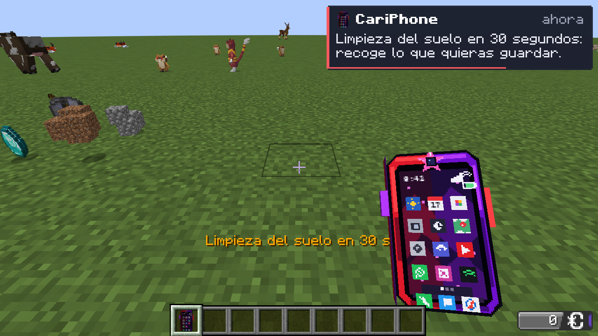

# Limpieza del suelo

Contra el lag: cada `intervalMinutes` (por defecto **15**; también se puede poner 10, 20 o lo que se quiera) el servidor retira lo que hay tirado en las zonas cargadas.

## Qué se limpia
- **Objetos en el suelo.**
- **Orbes de experiencia** (`xpOrbs`).
- **Flechas** sueltas o clavadas, también las espectrales (`arrows`). Los tridentes no se tocan.

Nunca toca mobs, Pokémon, marcos, soportes de armadura ni vehículos.

## Qué no se toca
- **Lo que suelta un jugador al morir.** COBBLEVERSE trae Lenient Death, que guarda esos objetos 15 minutos en el suelo y los hace brillar. Durante `protectDeathMinutes` (15) no se toca nada a menos de `protectDeathRadius` (10) bloques de donde murió. Tampoco cerca del último suelo que pisó, por si sus cosas se movieron al caer al vacío.
- Lo tirado hace menos de `protectNewSeconds` (20 s): da tiempo a pasarle algo al compañero.
- Los objetos **con nombre** (puestos en un yunque o por un mod), como los trofeos (`protectNamed`).
- La lista `protectedItems`: el CariPhone, el Trofeo del desafío, estrella del Nether, élitros, tótem, huevo de dragón, faro, núcleo denso, netherita, Master Ball y cajas de shulker. Admite ids y `#etiquetas`.

## Avisos

- Un minuto antes y a los 30 s, aviso del CariPhone a todos: «Limpieza del suelo en 60 segundos: recoge lo que quieras guardar».
- En la barra de acción, cuenta atrás a los 10 s y en los últimos 5 (con un sonido en los 3 últimos).
- Al terminar: «Limpieza del suelo: N objetos retirados. La próxima, en 15 minutos». También queda en el registro del servidor.

## Configuración (`config/caricraft.json`, bloque `cleaner`)
| Clave | Por defecto | Qué hace |
|---|---|---|
| `enabled` | `true` | Activa la limpieza |
| `intervalMinutes` | 15 | Cada cuántos minutos (1 a 240) |
| `warnings` | `true` | Avisos previos |
| `xpOrbs` / `arrows` | `true` | Incluir orbes de experiencia y flechas |
| `protectDeathMinutes` / `protectDeathRadius` | 15 / 10 | Protección alrededor de las muertes |
| `protectNewSeconds` | 20 | Edad mínima para borrar un objeto |
| `protectNamed` | `true` | No borrar objetos con nombre |
| `protectedItems` | (lista) | Objetos que nunca se borran |

Con `/caricraft reload` se aplica el nuevo intervalo sin reiniciar.

## Comandos (nivel 2)
- `/caricraft limpieza`: cuánto falta para la próxima.
- `/caricraft limpieza ahora`: limpia ya, dice cuántos objetos, orbes y flechas ha retirado y cuántos ha protegido, y reinicia la cuenta.
