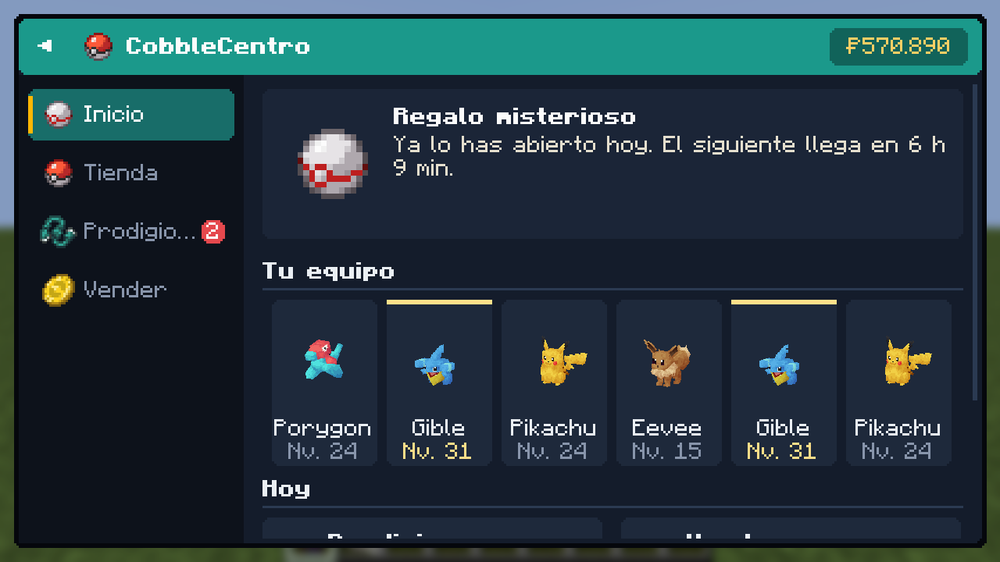
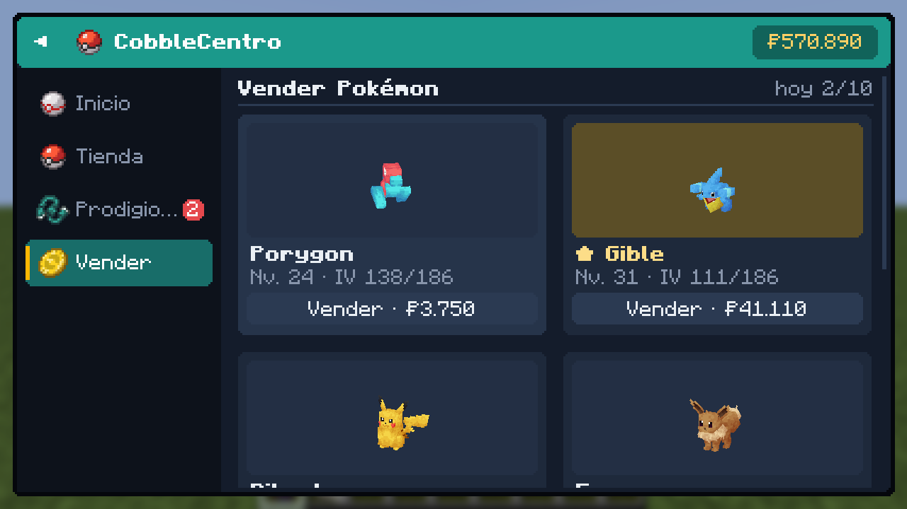
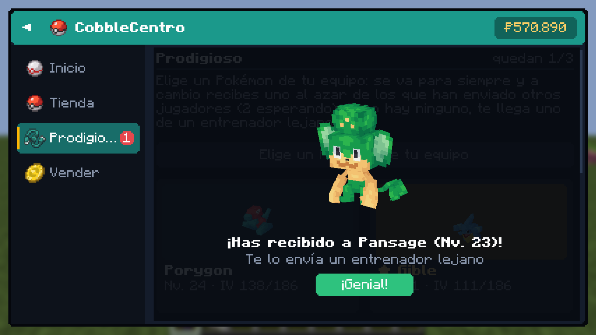
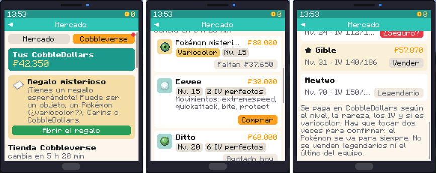
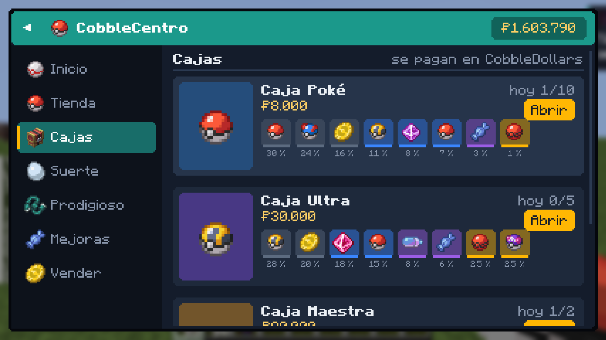
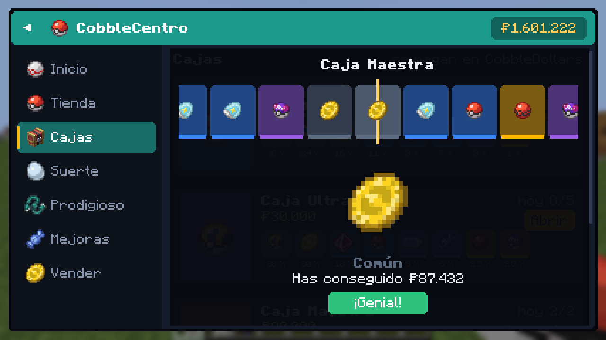
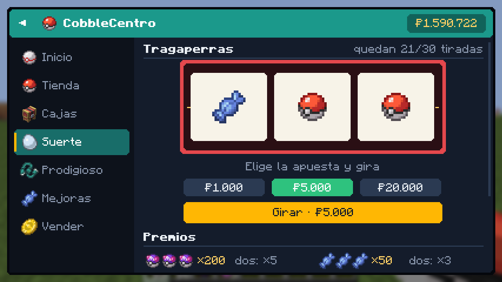
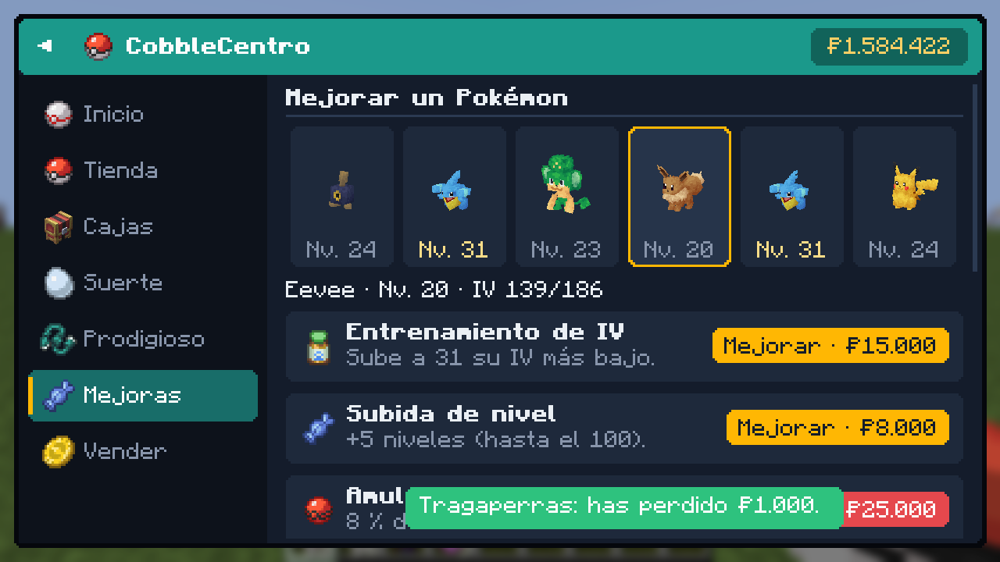

# Cobbleverse: CobbleCentro y pestaña del Mercado

La parte Cobbleverse aparece con `cobbleverse.enabled` (desactivado por defecto) y Cobblemon instalado. La tienda y la venta de Pokémon usan **CobbleDollars**, la moneda del modpack, no Carins. Se puede usar de dos formas:
- **CobbleCentro:** app del CariPhone que abre una pantalla grande con los **modelos 3D de los Pokémon**, como en el PC de Cobblemon. Tiene pestañas Inicio, Tienda, Cajas, Suerte, Prodigioso, Mejoras y Vender.
- **Pestaña Cobbleverse del Mercado:** lo mismo en formato teléfono, con un botón para abrir el CobbleCentro.

## CobbleCentro

- **Inicio:** regalo misterioso, tu equipo con sus modelos y accesos a lo de hoy (intercambios y ventas que quedan, cuándo cambia la tienda).
- **Tienda:** las ofertas del día con el Pokémon en 3D (si es variocolor, con sus colores) o el objeto en grande. Las ofertas de «Pokémon misterioso» van rotando entre las especies posibles.
- **Prodigioso:** intercambio prodigioso diario (ver abajo).
- **Vender:** el equipo en tarjetas con su modelo y el precio. Hay que tocar dos veces para confirmar.

  
- Los modelos giran al pasar el ratón por encima. Sin Cobblemon en el cliente se ve una Poké Ball en su lugar.
- Capturas tomadas con `tools/cobblemon_qa.py`: cliente de producción con Cobblemon 1.8.4 y CobbleDollars reales.
- La pantalla solo muestra lo que manda el servidor y le pide las acciones, igual que el teléfono. Con la tecla del teléfono se cierra; con ◀, Esc o el botón «atrás» del ratón se vuelve al CariPhone.

## Intercambio prodigioso

- **Uno al día por jugador** (`wonderTradesPerDay`). Eliges un Pokémon de tu equipo y se va para siempre.
- A cambio recibes uno al azar de la **bolsa de intercambios**: los Pokémon que han enviado **otros** jugadores (nunca uno tuyo). Llega tal cual lo envió su dueño: especie, nivel, IV, movimientos, mote y variocolor.
- Si en la bolsa no hay ninguno de otro jugador, te llega uno de **«un entrenador lejano»**: una especie al azar (sin legendarios, singulares, ultraentes ni paradoja), con un nivel parecido al del Pokémon que envías (±3), 2 IV perfectos y un 2 % de ser variocolor (`wonderShinyChance`).
- Tu Pokémon entra en la bolsa para otro jugador. Cuando alguien lo recibe, te llega un aviso: «Tu Pikachu (Nv. 24) del intercambio prodigioso le ha llegado a Dev2».
- La bolsa guarda como mucho `wonderPoolSize` (100) Pokémon; si se llena, sale el más antiguo. Se guarda en `data/caricraft_wonder.dat` del mundo.
- Animación: la Poké Ball se agita mientras se busca entrenador, destello y aparece el Pokémon recibido girando, con estrellas si es variocolor.
- No se puede intercambiar un legendario (salvo con `sellLegendaries`), el último Pokémon del equipo ni nada en mitad de un combate. El servidor lo vuelve a comprobar todo.
- Si algo falla al entregar, el intercambio se deshace y cada Pokémon vuelve a su sitio.

*Captura con datos de ejemplo en el entorno de desarrollo (sin Cobblemon, por eso los iconos y los nombres de movimientos salen genéricos; en el juego salen las Poké Balls y los nombres traducidos).*

## Cajas, tragaperras, mejoras y fusiones
Pestañas **Cajas**, **Suerte** y **Mejoras** del CobbleCentro. Todo se paga en CobbleDollars; el servidor cobra antes, decide el resultado y, si la entrega falla, devuelve el dinero. El cliente solo anima lo que le llega.

### Cajas

| Caja | Precio | Al día | Qué puede salir |
|---|---|---|---|
| Caja Poké | ₽8.000 | 10 | Poké/Super/Ultra Balls, ₽3.000–7.000, caramelos de exp. L, un Pokémon popular (3 % variocolor), caramelos raros y, con un 1 %, un Pokémon **variocolor** |
| Caja Ultra | ₽30.000 | 5 | Ultra Balls, ₽12.000–26.000, caramelos XL, un **pseudolegendario** bebé (Dratini, Larvitar, Gible, Beldum…), Cápsula habilidad, caramelos raros y, con un 2,5 % cada uno, un pseudolegendario variocolor o una **Master Ball** |
| Caja Maestra | ₽90.000 | 2 | ₽40.000–90.000, pseudolegendario con 4 IV perfectos, Parche habilidad, Pokémon variocolor, Master Ball y, con un 4 %, un **pseudolegendario variocolor con 6 IV perfectos** |

- En cada caja se ve el contenido con la **probabilidad** de cada premio y su **rareza** por colores (común, raro, épico, legendario). Al pasar el ratón sale qué es.
- Al abrirla, una **ruleta** horizontal frena hasta dejar el premio bajo la marca; después sale en grande (el Pokémon con su modelo 3D y estrellas si es variocolor).

  

### Tragaperras

- Apuestas de ₽1.000, ₽5.000 o ₽20.000; **30 tiradas por jugador y día**.
- Tres rodillos con Poké Ball, Super Ball, Ultra Ball, Baya Aranja, Caramelo raro y Master Ball. Tres iguales pagan de ×4 (Poké Ball) a **×200 (Master Ball)**; dos iguales, de ×0,5 a ×5.
- **A la larga devuelve el 91,5 % de lo apostado** (calculado exactamente en el servidor y mostrado en la pantalla): la banca gana un poco, como debe ser. No es una forma de hacer dinero.
- Un premio gordo (×100 o más) avisa también al compañero del dúo.

### Mejoras de Pokémon

| Mejora | Precio | Efecto |
|---|---|---|
| Entrenamiento de IV | ₽15.000 | Sube a 31 el IV más bajo |
| Subida de nivel | ₽8.000 | +5 niveles (hasta el 100) |
| Amuleto variocolor | ₽25.000 | **8 %** de hacerlo variocolor; si falla, se pierde el dinero |

- Se elige el Pokémon del equipo (con su modelo) y la mejora. No se puede si ya está al máximo o en mitad de un combate.
- El amuleto tiene suspense: el Pokémon gira mientras se decide y aparece con sus colores nuevos.
- Ninguna mejora sale rentable para vender después (ver precios de venta).

### Fusiones de objetos
| Ingredientes | Precio | Resultado |
|---|---|---|
| 4 Poké Balls | ₽200 | 2 Super Balls |
| 4 Super Balls | ₽600 | 2 Ultra Balls |
| 8 Ultra Balls | ₽20.000 | 1 Master Ball (**10 %**) |
| 3 caramelos de exp. L | ₽1.000 | 1 Caramelo raro |
| 3 Cápsulas habilidad | ₽15.000 | 1 Parche habilidad (**35 %**) |

- Los ingredientes salen del **inventario principal** (no de mochilas ni cofres). Si la fusión tiene probabilidad y falla, se pierden los ingredientes y el dinero.

### Configurarlo
- `crates`, `slots`, `upgrades` y `fusions` en el bloque `cobbleverse` de `config/caricraft.json` activan o quitan cada parte (todas activadas por defecto si `cobbleverse.enabled` lo está).
- Contenido, precios, probabilidades, apuestas, pagos y límites en `config/caricraft_cobbleverse.json` (secciones `crates`, `slots`, `upgrades` y `fusions`). Un archivo anterior que no las tenga recibe las del mod; una lista vacía a propósito se respeta.

## Regalo misterioso
- **Dos al día por jugador** (`giftsPerDay`). Se reinician a las **00:00** de la zona horaria del servidor (`timeZone` en `config/caricraft.json`, por defecto `Europe/Madrid`, con su horario de verano). Se abre con «Abrir el regalo»; la tarjeta dice cuántos quedan hoy.
- Premios al azar con pesos, en `config/caricraft_cobbleverse.json`:
  - **Objetos:**
    - Caramelos raros y de experiencia.
    - Ultra y Super Balls.
    - Piedras evolutivas.
    - Cápsula de habilidad.
    - Muy rara vez, una **Master Ball**.
  - **Pokémon:**
    - Uno de 17 especies populares a nivel 12, o un inicial a nivel 5.
    - Con 3 IV perfectos y un 5 % de probabilidad de ser variocolor.
    - Rara vez, uno **variocolor seguro**.
  - **CobbleDollars** (₽1.500–6.000). Si CobbleDollars no está instalado, sale otro premio.
  - **Carins** para el dúo (40–120).
- Si el equipo está lleno, el Pokémon va al PC.
- En la pestaña sale un punto rojo mientras el regalo esté sin abrir.

## Tienda en CobbleDollars
Cada día salen **6 ofertas** de un catálogo de 24. Son las mismas para todos y se pueden comprar un número de veces al día por jugador. Son caras a propósito, para que valga la pena farmear:

| Tipo | Ejemplos | Precio |
|---|---|---|
| Variocolor | Pokémon misterioso variocolor (25 especies), Eevee variocolor, inicial variocolor | ₽80.000–95.000 |
| Movimientos que no podrían aprender | Eevee, Growlithe o Riolu con Velocidad Extrema; Beldum con Puño Meteoro; Magikarp con Danza Dragón y Cascada; Pikachu con Surf y Vuelo; Dratini con Velocidad Extrema | ₽25.000–50.000 |
| IV perfectos | Ditto, Larvitar o Gible con 6 IV perfectos | ₽55.000–60.000 |
| Objetos raros | Master Ball, Parche y Cápsula de habilidad, 5 caramelos raros, 3 caramelos de exp. XL, Huevo Suerte, Lazo Destino, piedras alba y noche, Vidasfera, Cinta Elección | ₽12.000–150.000 |

- Los Pokémon se crean en el servidor con la API de Cobblemon:
  - Especie, nivel y variocolor (`PokemonProperties`).
  - IV a 31 en estadísticas al azar.
  - Movimientos puestos en su lista aunque no estén en su aprendizaje (`Moves.getByName`).
- El comprador queda como entrenador original.
- Se cobra antes de entregar. Si la entrega falla, se devuelve el dinero.

## Vender Pokémon por CobbleDollars
- Lista del **equipo** con lo que se paga por cada uno. Hay que tocar **dos veces** para confirmar (el Pokémon se va para siempre).
- **Precio:** `(150 + 30 × nivel) × rareza × IV × variocolor × legendario × sellPriceMultiplier`, redondeado a decenas.
  - Rareza: de ×1 (ratio de captura 255) a ×4 (ratio 3).
  - IV: de ×0,5 a ×1,5 según los IV totales.
  - Variocolor: ×10.
  - Legendario: ×5 (solo si se permite venderlos).
- **Ejemplos:**

| Pokémon | Precio |
|---|---|
| Pidgey nv. 20 con IV medios | ₽750 |
| Gible nv. 31 variocolor | ≈ ₽58.000 |
| Eevee nv. 15 variocolor con 6 IV perfectos | ₽31.240 (muy por debajo de su precio en tienda: no hay forma de sacar dinero comprando y vendiendo) |

- **No se puede vender:**
  - Legendarios, singulares ni ultraentes (`sellLegendaries`, desactivado).
  - El último Pokémon del equipo.
  - Nada en mitad de un combate.
  - Más de `maxSalesPerDay` (10) al día.
- El servidor vuelve a comprobarlo todo y calcula el precio con sus propios datos. Si no se pudiera pagar, el Pokémon vuelve al equipo.

## Configuración (`config/caricraft.json`, bloque `cobbleverse`)
| Clave | Por defecto | Qué hace |
|---|---|---|
| `enabled` | `false` | Activa la pestaña y los objetos de Cobblemon en el Mercado de Carins |
| `mysteryGift` / `shop` / `sellPokemon` | `true` | Cada parte por separado |
| `maxSalesPerDay` | 10 | Ventas por jugador y día |
| `sellPriceMultiplier` | 1.0 | Multiplica lo que se paga |
| `sellLegendaries` | `false` | Permite vender (e intercambiar) legendarios |
| `giftsPerDay` | 2 | Regalos misteriosos por jugador y día |
| `wonderTrade` | `true` | Intercambio prodigioso |
| `wonderTradesPerDay` | 1 | Intercambios prodigiosos por jugador y día |
| `wonderShinyChance` | 0.02 | Probabilidad de variocolor de los Pokémon de «un entrenador lejano» |
| `wonderPoolSize` | 100 | Pokémon que caben en la bolsa de intercambios |
| `crates` / `slots` / `upgrades` / `fusions` | `true` | Cajas, tragaperras, mejoras de Pokémon y fusiones de objetos |

- Quien ya tenía `market.includeCobblemonItems: true` pasa a tener `cobbleverse.enabled: true` (migración a la versión 3 de la configuración).
- El catálogo (ofertas, precios, premios y pesos) se puede cambiar en `config/caricraft_cobbleverse.json`. Si no existe, se usa el del mod.
- Los objetos y especies que no existen en el servidor se descartan al cargar.

## Comprobación en un servidor
`/caricraft cobbleverse prueba` (nivel 4, también desde la consola) usa un jugador ficticio para comprobar:
- Crear un Pokémon de tienda (variocolor, IV y movimientos especiales).
- Quitarlo y devolverlo al equipo.
- Guardarlo en la bolsa del intercambio prodigioso y recuperarlo idéntico, y elegir una especie al azar para «un entrenador lejano».
- Sumar y restar CobbleDollars.

Al terminar deja todo como estaba. Conviene usarlo al actualizar el modpack.

## CobbleDollars
- Licencia «All rights reserved»: **no se compila contra él ni se incluye nada suyo**.
- CobbleDollars añade a cada jugador la interfaz `CobbleDollarsPlayer` (getter y setter de `BigInteger`), y `CobbleDollarsBridge` la usa por reflexión.
- El saldo va en los datos sincronizados del jugador, así que se ve al momento.
- Si la API cambia, la tienda y la venta se desactivan con un aviso en el registro. El resto del mod sigue.
- Decisión en `docs/decisions/ADR-006-COBBLEDOLLARS.md`.
