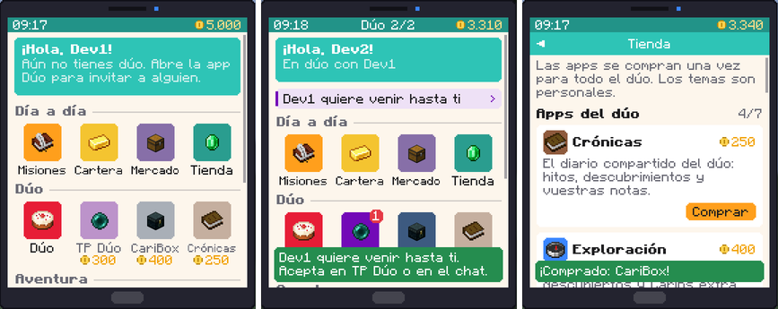

# CariPhone

Ítem `caricraft:cariphone`. Se fabrica con 5 lingotes de hierro, 1 panel de cristal y 1 polvo de redstone, y cada jugador recibe uno al entrar por primera vez (configurable). Se abre con clic derecho o con la tecla configurable (por defecto `O`, si se lleva un CariPhone en el inventario).

## Pantalla
- Marco de teléfono centrado que se adapta a la escala de la GUI.
- Barra de estado con la hora, el dúo conectado y el saldo de Carins.
- Estados: cargando, sin datos, bloqueada (con precio) y error de protocolo.

### Inicio
1. **Tarjeta de bienvenida** con el nombre y el compañero.
2. **Avisos:** filas de color con acceso directo a la app donde se resuelven:
   - Petición de TP Dúo recibida.
   - Invitación al dúo.
   - Desafío en curso o esta noche.
   - Misiones por cobrar.
   - Petición de viaje enviada.
3. **Apps por secciones**, en cuadrícula de 4 columnas:

| Sección | Apps |
|---|---|
| Día a día | Misiones, Cartera, Mercado, Tienda |
| Dúo | Dúo, TP Dúo, CariBox, Crónicas |
| Aventura | Desafío Dúo, Exploración, CariCamp, CariLens |
| Sistema | Estadísticas, Ajustes |
| Otras | Cualquier app nueva que no esté en la lista |

- Las apps sin comprar se ven atenuadas y con su precio. Al pulsarlas se abre su ficha con el botón de compra.
- Globos rojos: misiones por cobrar, invitaciones, petición de TP Dúo y «!» en Desafío Dúo cuando toca esa noche.
- Algunas apps usan un nombre corto en la cuadrícula: Desafío, Explorar, Récords.

### Navegación
- Cada página que se abre se guarda en un **historial** (hasta 16 pasos) con su desplazamiento:
  - Si vas, por ejemplo, de CariCamp a TP Dúo, «atrás» te devuelve a CariCamp en el mismo punto.
  - Si vas de una app bloqueada a la Tienda, «atrás» vuelve a la ficha de esa app.
- Formas de volver atrás:
  - La flecha **◀** de la cabecera.
  - **Esc**: primero deja de escribir, luego vuelve atrás y, en el inicio, cierra.
  - El **botón lateral «atrás» del ratón**.
  - En CariLens, «atrás» primero cierra la foto abierta.
- El **botón de inicio** del marco vuelve al inicio y vacía el historial.
- La tecla del teléfono (`O`) lo cierra desde cualquier página.
- Al volver a abrir el teléfono se recupera la última página, y «atrás» lleva al inicio.

### Tienda
Tres secciones (apps, mejoras y temas), cada una con un contador `compradas/total`. Dentro de cada sección, primero aparece lo que se puede comprar, luego lo que tiene requisitos y al final lo que ya se tiene.

## Apps
| App | Tipo | Función |
|---|---|---|
| Misiones | Gratis | Lista, aceptar, abandonar, entregar y reclamar. |
| Cartera | Gratis | Saldo y últimos movimientos. |
| Dúo | Gratis | Miembros, invitaciones y desvinculación. |
| Tienda | Gratis | Comprar apps y temas. |
| Ajustes | Gratis | Elegir tema del teléfono. |
| Mercado | Gratis | Ofertas diarias de objetos por Carins (`docs/MARKET.md`). |
| Desafío Dúo | Gratis | Estado de la noche de desafío, nivel, historial y botón para adelantarla (`docs/CHALLENGE.md`). |
| Crónicas | 250 | Diario compartido y notas. |
| Exploración | 400 | Biomas descubiertos + bonificación por bioma nuevo. |
| Estadísticas | 200 | Distancia, capturas, victorias, misiones del dúo. |
| CariBox | 400 | Cofre compartido del dúo desde el teléfono; ampliación por filas (250, hasta 3 veces) (`docs/CARIBOX.md`). |
| TP Dúo | 300 | Dónde está el compañero (cara, bioma, distancia y brújula) y viajes estilo /tpa para ir a su lado o traerlo (`docs/TPDUO.md`). |
| CariCamp | 400 | Campamento del dúo en una hoguera, brújula y viaje de vuelta (`docs/CARICAMP.md`). |
| CariLens | 300 | Álbum de fotos compartido; ampliación de álbum (200, hasta 4 veces) en Mejoras (`docs/CARILENS.md`). |

La UI no decide precios ni desbloqueos: todo viene del snapshot del servidor.
