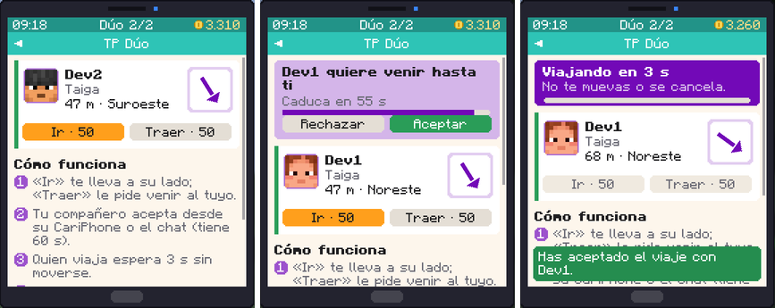

# TP Dúo

App de pago del dúo (300 Carins, perla de ender morada). Sirve para viajar junto al compañero con su permiso, al estilo `/tpa`. Antes formaba parte de CariCamp; ahora es una app propia con interfaz, y los comandos quedan como atajo.

## Pantalla
- **Sin dúo:** explica para qué sirve y tiene un botón que lleva a la app Dúo.
- **Tarjeta del compañero:**
  - Su **cara** (la skin del jugador) y su nombre.
  - El **bioma** en el que está.
  - La **distancia y el punto cardinal**, o la dimensión si está en otra («En el Nether»).
  - Una **brújula** que apunta hacia él según hacia dónde mira el jugador.
  - Botones **Ir · 50** y **Traer · 50**.
  - Si está desconectado, la tarjeta lo indica y no hay botones.
- **Petición recibida:** tarjeta destacada con el nombre, una barra con el tiempo que queda y los botones **Rechazar** / **Aceptar**.
- **Petición enviada:** cuánto queda y botón **Cancelar**.
- **Cuenta atrás:** tarjeta con los segundos que faltan y una barra. Avisa de que, si te mueves, se cancela.
- **Avisos:**
  - Noche de desafío (no se puede viajar).
  - Espera entre viajes.
  - Carins que faltan.
- **Cómo funciona:** cuatro pasos numerados y el atajo de chat.

Las peticiones recibidas también aparecen en el inicio del CariPhone, como aviso y con un globo rojo sobre el icono de TP Dúo.

## Reglas
- **Ir:** pides ir hasta tu compañero. **Traer:** le pides que venga contigo.
- El compañero puede aceptar desde:
  - TP Dúo.
  - El mensaje del chat, con **[Aceptar] [Rechazar]** clicables.
  - `/tpduo aceptar` o `/tpduo rechazar`.
- La petición caduca a los `camp.requestSeconds` (60 s). Una nueva sustituye a la anterior.
- Tras aceptar empieza una **cuenta atrás** de `camp.warmupSeconds` (3 s). Si quien viaja se mueve, se cancela.
- Se cobra al llegar `camp.partnerTravelCost` (50 Carins). Si el teletransporte falla, se devuelve.
- Después hay `camp.cooldownSeconds` (5 min) de espera para quien viaja. La espera es la misma que la de CariCamp.
- **Durante la noche de desafío no se puede viajar** (`camp.blockDuringChallenge`).
- La posición y el bioma del compañero solo se envían a los miembros del propio dúo, y solo si tienen la app.

Las claves de configuración siguen en el bloque `camp` de `config/caricraft.json` para no romper configuraciones existentes.

## Comandos
| Comando | Qué hace |
|---|---|
| `/tpduo` o `/tpduo ir` | Pide ir hasta tu compañero |
| `/tpduo traer` | Pide que tu compañero venga contigo |
| `/tpduo aceptar` / `/tpduo rechazar` | Responde a la petición recibida (rechazar también cancela la tuya) |

`/caricraft viaje …` funciona igual. Los comandos necesitan la app comprada, igual que los botones.

## Partidas anteriores
Hasta ahora, los viajes con el compañero venían con CariCamp. Al cargar un mundo guardado con el esquema 1, los dúos que ya tenían CariCamp reciben TP Dúo gratis (esquema 2, `StateCodec.migrate`). Así nadie pierde algo que ya había pagado.

## En qué se diferencia de Waystones
| | Waystones | TP Dúo |
|---|---|---|
| Destino | Piedras fijas repartidas por el mundo | Tu compañero, esté donde esté |
| Consentimiento | No | El compañero tiene que **aceptar** (como /tpa) |
| Sentido | Solo ir | **Ir** hasta él o **traerlo** contigo |
| Coste | Experiencia | Carins, al llegar |
| Tiempo | Inmediato | Cuenta atrás sin moverse y espera entre viajes |
| Noche de desafío | Sin restricción | Bloqueado |
